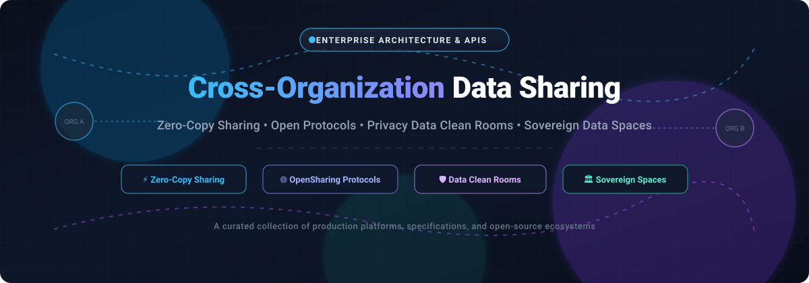

# Awesome Cross-Organization Data Sharing 🌐 🤝 ⚡

  

  
  
  
  
  

  <strong>Curated collection of SaaS products, open protocols, and open-source platforms for zero-copy data sharing, privacy data clean rooms, and sovereign federated data spaces. 🌟 Star if you find it helpful! 🌟</strong>

---

## 📖 Table of Contents

- [📊 Sector Overview & Market Dynamics](#-sector-overview--market-dynamics)
- [🏢 SaaS/Hosted Platforms](#-saashosted-platforms)
- [🔓 Open-Source GitHub Projects](#-open-source-github-projects)
- [🤝 How to Contribute](#-how-to-contribute)
- [💖 Support & Sponsorship](#-support--sponsorship)
- [⭐ Star History](#-star-history)
- [⚖️ Disclaimer](#️-disclaimer)

---

## 📊 Sector Overview & Market Dynamics

The global **Data Sharing-as-a-Service (DSaaS)** market is valued at approximately **$3.97B to $4.2B** (with the privacy-focused **Data Clean Room** subsegment representing ~$1.4B–$1.9B), expanding at an **18%–21% CAGR**. 

The sector is **moderately fragmented yet increasingly bifurcated**:
1. **Hyperscaler & Data Cloud Concentration (Winner-Take-All Dynamics)**: Core zero-copy compute and storage federation exhibits high concentration among major data cloud hyperscalers (Microsoft Azure, AWS, Snowflake, Databricks). These vendors leverage deep ecosystem lock-in, proprietary reader accounts, and unified catalog layers.
2. **Specialized & Cross-Party Fragmentation**: Independent commercial data exchange software, sovereign dataspace connectors, and privacy-enhancing clean rooms remain fragmented across domain specialists (Dawex, Harbr, InfoSum, LiveRamp) and decentralized open protocol initiatives (such as Linux Foundation OpenSharing and Eclipse Dataspace Components).

---

## 🏢 SaaS/Hosted Platforms

| Platform | Company Size (Revenue / Valuation) | Starting Pricing Tier | Free Tier Limits / Free Trial | Key Capabilities & Trade-offs |
| :--- | :--- | :--- | :--- | :--- |
| **[Azure Data Share](https://azure.microsoft.com/en-us/products/data-share)** | **$3.1T+** Market Cap (Microsoft) | **$0.05 / dataset-snapshot** + **$0.50 / vCore-hour** execution (prorated by minute) | **30-Day Free Trial** with **$200 Azure credits**; includes access to 55+ always-free Azure services (standard Azure storage/compute charges apply after credits) | 🔄 Snapshot-based sharing across Azure tenants. Provider pays all snapshot and compute costs; data is copied rather than queried via zero-copy. |
| **[AWS Data Exchange](https://aws.amazon.com/data-exchange/)** | **$2.1T+** Market Cap (Amazon) | **3% fulfillment fee** on data transactions + **$0.04167/hour** per active data grant + S3 storage ($0.023/GB/mo) | **AWS Free Tier (12 months free / always-free limits)** plus provider-specific **free trial data products** (e.g., 7–30 day trial access to selected public/commercial datasets) | 🛒 Cloud-native data marketplace integrated with AWS billing and EDP drawdowns. Egress fees can escalate on multi-TB products; private offers negotiable. |
| **[Snowflake Data Sharing](https://www.snowflake.com/)** | **~$50B** Market Cap | **$2.00 / credit** (Standard Edition) to **$3.00 / credit** (Enterprise Edition) compute consumption | **30-Day Free Trial** with **$400 in free usage credits** (no permanent free tier; Reader Accounts allow recipients to query without paid subscriptions, billed to provider) | ⚡ Native zero-copy data sharing without ETL or data movement. Reader accounts enable sharing with non-Snowflake customers but push compute expenses to provider. |
| **[Databricks Delta Sharing / OpenSharing](https://www.databricks.com/product/delta-sharing)** | **$43B** Valuation / **$2.6B+ ARR** | **$0.07 / DBU** (Standard Plan) to **$0.55 / DBU** (Enterprise Jobs/Compute) | **14-Day Free Trial** on full cloud platform; **Databricks Community Edition** is free forever with 1 micro-cluster (15GB single node, Delta Sharing hosting excluded) | 🌐 Open zero-copy sharing of tables, volumes, models, and agent skills via credential vending. Built on open OpenSharing protocol, managed via Unity Catalog. |
| **[LiveRamp Safe Haven](https://liveramp.com/)** | **~$2.0B** Market Cap (NYSE: RAMP) / **~$750M ARR** | **$20,000 / year** (Standard Tier for <5M customer records and 1–3 destinations) | **No Free Tier or Self-Serve Trial**; evaluation requires a guided custom Proof of Concept (PoC) or guided interactive sandbox demo | 🛡️ Privacy-preserving enterprise data clean room and identity resolution engine for multi-party marketing and analytics. |
| **[InfoSum](https://www.infosum.com/)** | **~$150M** Acquisition Value (WPP) / **~$10M–$15M ARR** | **~$3,000 / month** base platform contract (or private offer via AWS/GCP/Snowflake marketplaces) | **No Free Tier or Self-Serve Trial**; requires custom enterprise contract or proof-of-concept; Snowflake Native App Beacons free to deploy but require platform license | 🔒 Decentralized data collaboration with Bunkers and Snowflake Beacons. Raw data never moves; privacy-safe vector matching across clouds. |
| **[Harbr](https://www.harbrdata.com/)** | **~$169M** Valuation / **~$50M** Total Raised | **~$2,500 / month** ($30,000/yr starting enterprise pilot deployment) | **No Free Tier or Self-Serve Trial**; evaluation is restricted to custom private enterprise sandbox walkthroughs and sales demos | 🏬 White-label data commerce and marketplace platform connecting existing VPCs; enables custom branded enterprise data exchanges. |
| **[Revelate](https://www.revelate.com/)** | **~$100M–$150M** Est. Valuation / **~$10M–$20M ARR** | **~$2,000 / month** ($25,000/yr starting enterprise data distribution license) | **No Free Tier or Self-Serve Trial**; prospective buyers must request a custom platform demonstration and guided evaluation trial | 📦 Turnkey data marketplace and fulfillment engine (formerly TickSmith); automates external packaging and commercialization workflows. |
| **[Dawex](https://www.dawex.com/)** | **~$50M–$80M** Est. Valuation / **~$9.6M ARR** | **~$1,500 / month** (€18,000/yr baseline private data exchange SaaS license) | **No Free Tier or Self-Serve Trial**; access is restricted to structured corporate demos and pilot evaluations | 🇪🇺 Enterprise data exchange software powering corporate and regional trusted data spaces complying with European Data Governance Act frameworks. |
| **[ThinkData Works (Namara)](https://www.thinkdataworks.com/)** | **~$15M–$25M** Est. Valuation / **~$2.2M ARR** | **~$1,000 / month** ($12,000/yr starter data catalog & marketplace tier) | **No Free Tier or Self-Serve Trial**; offers personalized product walkthroughs and 14-day assisted enterprise trials upon qualification | 📑 Focuses on public/alternative data aggregation, cataloging, and automated enrichment across 100K+ external public sources. |

---

## 🔓 Open-Source GitHub Projects

Repositories are sorted in descending order of GitHub stargazers:

1. ### **[OpenMined/PySyft](https://github.com/OpenMined/PySyft)** 
   - **Description**: A comprehensive open-source privacy-preserving framework for secure, multi-party data science and cross-organization data collaboration without moving or disclosing private data.
   - **Key Features**: Remote execution via privacy-preserving Domain and Network nodes; differential privacy; secure multi-party computation (SMPC); granular role-based approvals for data scientists across independent organizations.
   - **License**: Apache-2.0
   - **Best For**: Organizations, healthcare entities, and research groups executing joint analytics and model training without centralizing sensitive datasets.

2. ### **[ckan/ckan](https://github.com/ckan/ckan)** 
   - **Description**: The world’s leading open-source data management system (DMS) and data portal platform powering hundreds of national, regional, and inter-organizational public data exchanges.
   - **Key Features**: Comprehensive metadata cataloging; geospatial discovery; fine-grained access permissions; federated harvesting from external partner catalogs; extensive Python plugin architecture.
   - **License**: AGPL-3.0
   - **Best For**: Public sector bodies, non-profits, and inter-agency federations requiring production-grade public and semi-private data exchange infrastructure.

3. ### **[secretflow/secretflow](https://github.com/secretflow/secretflow)** 
   - **Description**: An industrial-grade unified framework for privacy-preserving data intelligence, federated learning, and cross-party secure computing.
   - **Key Features**: Privacy-preserving federated machine learning algorithms; trusted execution environment (TEE) integration; secure multi-party computation (MPC); confidential data clean room primitives.
   - **License**: Apache-2.0
   - **Best For**: Financial institutions, advertising ecosystems, and telecommunications enterprises requiring high-performance private multi-party computation.

4. ### **[delta-io/delta-sharing](https://github.com/delta-io/delta-sharing)** 
   - **Description**: The foundational open-source protocol and reference server implementation for secure zero-copy sharing of large datasets across cloud storage providers.
   - **Key Features**: Direct cloud credential vending (S3, ADLS, GCS); native connector support for pandas, Apache Spark, Power BI, and Rust; open REST API specification for tabular data products.
   - **License**: Apache-2.0
   - **Best For**: Teams maintaining existing Delta Lake environments seeking standard REST-based zero-copy data distribution to external partners.

5. ### **[magda-io/magda](https://github.com/magda-io/magda)** 
   - **Description**: Cloud-native, Kubernetes-based federated data catalog system designed for automated cross-agency and inter-organizational dataset discovery.
   - **Key Features**: Automated metadata harvesting from disparate organizational portals (CKAN, CSW, OpenDataSoft); Open Policy Agent (OPA) integration for authorization; rich web UI for data consumer discovery.
   - **License**: Apache-2.0
   - **Best For**: Large federations, governments, and enterprise conglomerates establishing unified discovery across decentralized business units.

6. ### **[eclipse-edc/Connector](https://github.com/eclipse-edc/Connector)** 
   - **Description**: Eclipse Dataspace Components (EDC) provides the reference open-source implementation of the Dataspace Protocol for secure, sovereign B2B data sharing.
   - **Key Features**: Decentralized identity (DID / Verifiable Credentials) trust validation; automated contract negotiation and contract agreement lifecycle; policy enforcement at transfer time; native cloud data plane transfer drivers (S3, Azure Blob).
   - **License**: Apache-2.0
   - **Best For**: European and international enterprises building sovereign data spaces complying with Gaia-X and the EU Data Act.

7. ### **[OpenSharing-IO/OpenSharing](https://github.com/OpenSharing-IO/OpenSharing)** 
   - **Description**: Linux Foundation AI & Data open protocol standard for zero-copy sharing of tables, unstructured file volumes, machine learning models, and AI agent skills.
   - **Key Features**: Vendor-neutral open protocol; credential vending across AWS S3, Azure ADLS, GCP Cloud Storage, and Cloudflare R2; multi-format support (Parquet, Delta Lake, Apache Iceberg); first-class sharing schema for AI AgentSkills and models.
   - **License**: Apache-2.0
   - **Best For**: Modern multi-platform data and AI teams building vendor-neutral sharing architectures across independent clouds.

8. ### **[FIWARE/data-space-connector](https://github.com/FIWARE/data-space-connector)** 
   - **Description**: Open-source connector bridging FIWARE Smart Data Models and NGSI-LD context brokers with the Eclipse Dataspace Components (EDC) standard.
   - **Key Features**: Sovereign cross-organization exchange of real-time IoT and context data; contract negotiation and policy control; turn-key integration with European data space architectures.
   - **License**: Apache-2.0
   - **Best For**: Smart cities, smart agriculture, and IoT manufacturing consortia exchanging contextualized live operational telemetry.

9. ### **[Fraunhofer-AISEC/trusted-connector](https://github.com/Fraunhofer-AISEC/trusted-connector)** 
   - **Description**: Reference implementation of the International Data Spaces (IDS) connector architecture with hardware-rooted remote attestation and dynamic usage control.
   - **Key Features**: Trusted execution environment (TEE) and TPM hardware integration; IDSCP2 secure communication protocol; Camel routing engine with real-time policy enforcement.
   - **License**: Apache-2.0
   - **Best For**: Edge computing and industrial IoT environments demanding hardware-verified execution and sovereign cross-enterprise data governance.

10. ### **[International-Data-Spaces-Association/ids-specification](https://github.com/International-Data-Spaces-Association/ids-specification)** 
    - **Description**: The foundational Dataspace Protocol specifications defining schemas, interaction flows, and usage control models for interoperable cross-organization data exchange.
    - **Key Features**: Catalog protocol, contract negotiation protocol, and transfer process protocol definitions based on open W3C standards (DCAT, ODRL, JSON-LD).
    - **License**: Apache-2.0
    - **Best For**: Architects, standard bodies, and developers implementing interoperable connectors for sovereign data spaces.

11. ### **[tiktok-privacy-innovation/PrivacyGo-DataCleanRoom](https://github.com/tiktok-privacy-innovation/PrivacyGo-DataCleanRoom)** 
    - **Description**: An open-source confidential cloud data clean room framework leveraging Trusted Execution Environments (TEEs) such as Google Confidential Space.
    - **Key Features**: Multi-party cryptographic attestation; isolated notebook-based collaboration; policy verification ensuring raw partner data cannot be accessed or exfiltrated by any participant.
    - **License**: Apache-2.0
    - **Best For**: Cross-company advertising, conversion attribution, and audience overlap analysis requiring hardware-enforced isolation.

---

## 🤝 How to Contribute

We welcome community contributions! To add a new platform or open-source framework:

1. 🍴 **Fork the repository** on GitHub.
2. 📝 **Add or update entries** in `README.md` following the established tabular or list formats.
3. 🔍 **Verify details**: Include verifiable pricing/valuation info for SaaS platforms or star badge links, license, and repo descriptions for open-source tools.
4. 🚀 **Submit a Pull Request** with a concise description of your additions.

---

## 💖 Support & Sponsorship

If you find this curated collection useful for your architectural research or enterprise data projects, please consider supporting the project:

- ⭐ **Star this repository** to help others discover it!
- 🍴 **Fork and share** with colleagues and data engineering communities.
- ☕ **Sponsor the maintainer** via the [GitHub Sponsor Dashboard](https://github.com/sponsors/ishandutta2007) to help support ongoing maintenance and new ecosystem research!

---

## ⭐ Star History

---

## ⚖️ Disclaimer

- This is an **independent, community-curated list** — entries do not imply vendor endorsement.
- Cross-organization data sharing platforms handling partner data must comply with international and regional data regulations (GDPR, CCPA, EU Data Act), corporate data governance policies, and binding data sharing agreements.
- **Architectural Paradigms**:
  - **Zero-Copy Sharing** (*Snowflake*, *Databricks Delta Sharing*, *OpenSharing*): Data remains in provider cloud storage while recipients query live data directly via scoped credential vending.
  - **Snapshot Sharing** (*Azure Data Share*): Data is periodically replicated into consumer environments; compute and snapshot fees are billed to the provider.
  - **Data Clean Rooms** (*LiveRamp*, *InfoSum*, *PySyft*, *SecretFlow*, *PrivacyGo*): Cryptographic or TEE-governed environments designed to facilitate multi-party analytics and matching without disclosing underlying record-level identities.
  - **Sovereign Data Spaces** (*Eclipse EDC*, *FIWARE*, *IDSA*): Policy-driven peer-to-peer data sovereignty frameworks facilitating trusted B2B bilateral exchanges.
- Pricing metrics, valuations, and stargazers fluctuate over time. Always verify current commercial pricing with respective vendor sales teams.
